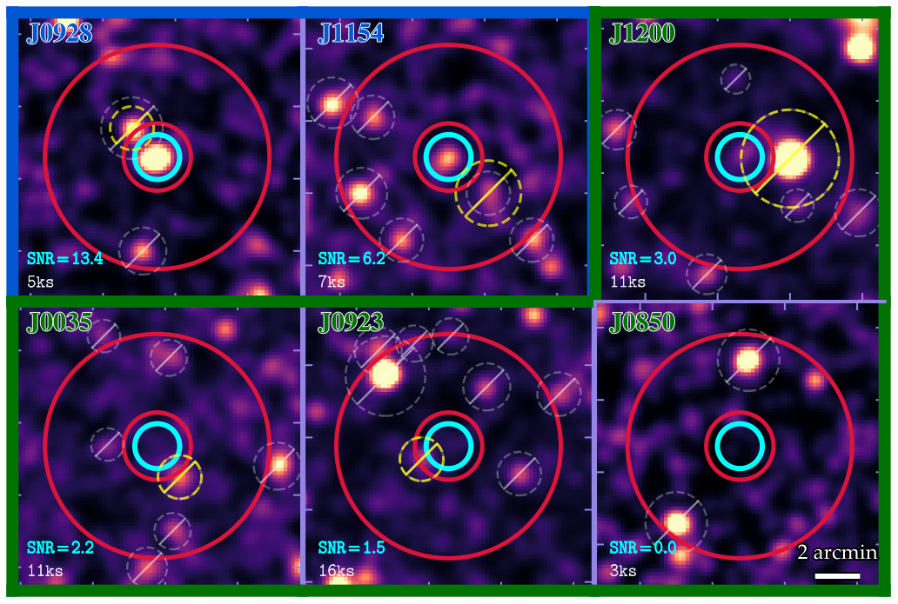
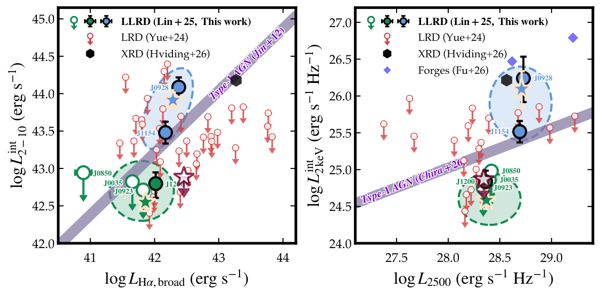
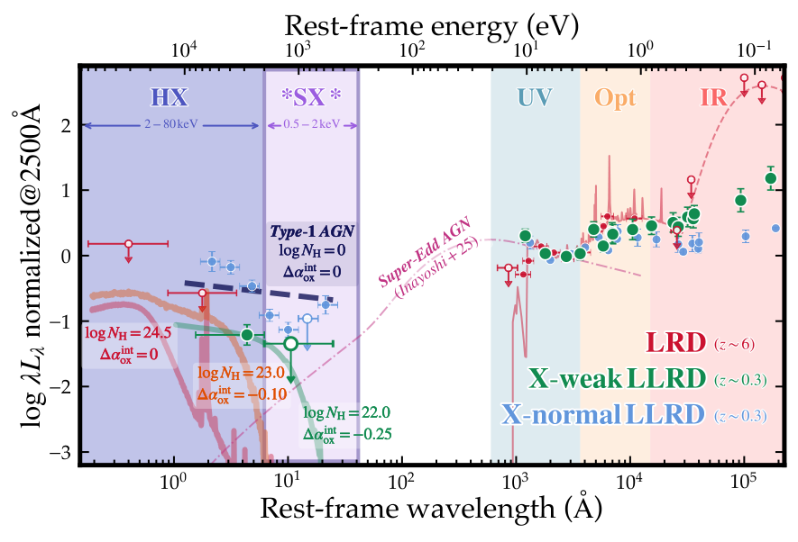
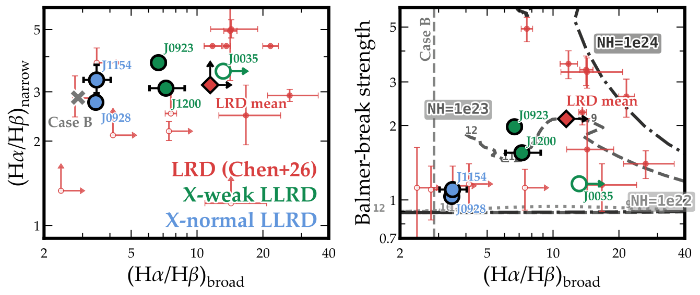
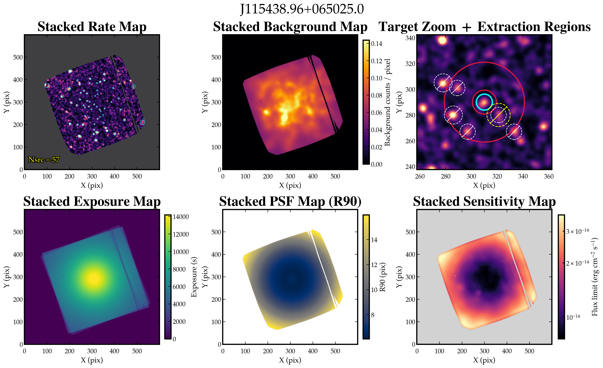
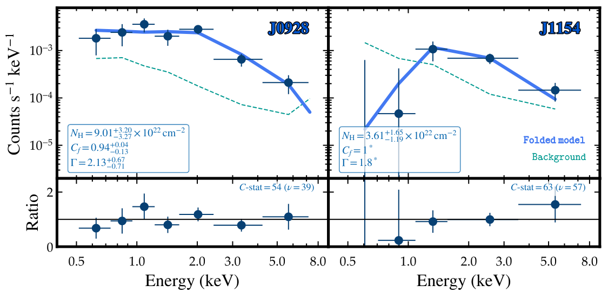

<!-- votes: 2 -->

# Little Green Dots in X-rays: Local Clues to the X-ray Weakness of JWST's Little Red Dots

Shi-Jiang Chen, Jun-Xian Wang, Zhen-Ya Zheng, Ruqiu Lin, Luis C. Ho, Zhen-Yi Cai, Chang-Hao Chen, Zsofi Igo et al.

**Abstract:** A major question about JWST's little red dots (LRDs) at $z\sim4-8$ is the origin of their apparent X-ray weakness. Even deep Chandra stacks yield only tentative detections or broad-band limits and cannot distinguish among super-Eddington accretion, intrinsic X-ray weakness, and Compton-thick (CT) obscuration.
Local analogs offer a powerful complementary route. At $z\sim0.3$, similarly luminous sources require $\sim10^{3-4}$ less exposure for comparable signal-to-noise, suffer less source confusion, and directly probe the diagnostic rest-frame soft X-rays.
Here we present a pilot Einstein Probe/FXT study of six ``local little red dots'' (LLRDs), V-shaped broad-line green pea galaxies selected as low-redshift counterparts of LRDs.
These sources show X-ray diversity: ``X-normal'' LLRDs resemble type 1 AGNs in X-ray luminosity and optical variability, whereas ``X-weak'' stack lies simqtyrange[range-phrase=--,range-units=single]0.50.7dex below standard unobscured-quasar scaling relations while remaining compatible with the representative LRD stack and $\qty{95}{\%}$ of published individual limits. The X-weak LLRDs also lack detected optical variability and have redder optical continua than X-normal LLRDs, making their V-shaped SEDs closer to those of high-redshift LRDs.
The detection of the X-weak stack at $\sim3.3\sigma$ with the soft-X-ray-sensitive EP-FXT provides rest-frame $\sim2-3\,\mathrm{keV}$ constraints difficult to reconcile with a typical unobscured super-Eddington model or a local-AGN-like CT geometry examined here, although modified variants remain possible. The simplest alternative is a mildly X-ray-weak corona ($\Delta\alpha_\mathrm{ox}\sim-0.1$ to $-0.2$) with Compton-thin absorption ($N_\mathrm{H}\sim10^{22-23}\,\mathrm{cm}^{-2}$), consistent with the independent Balmer decrement/break diagnostics.
Together with growing samples of local LRD analogs, our results offer a practical path for testing the physical nature of LRD X-ray weakness.

**Figure 1. -** Observed-frame epfxt qtyrange[range-phrase=--,range-units=single]0.54keV exposure-corrected count-rate images, coadded over all observations and detector modules and smoothed with a Gaussian kernel of $\sigma=2$ pixels ($\simeq\ang{;;19}$). Cyan circles and crimson annuli mark the source and background apertures; yellow and gray circles show contaminant masks. Labels give the extraction-based SNR and effective exposure. Blue and green frames denote X-normal and X-weak LLRDs. (*fig:xray_image*)

**Figure 2. -** Intrinsic X-ray emission of LLRDs benchmarked against AGNs and high-redshift LRDs. Left: qtyrange[range-phrase=--,range-units=single]210keV luminosity versus broad-ha luminosity; right: keV monochromatic luminosity versus rest-frame AA luminosity. X-weak LLRDs are green (open circles: upper limits; filled circle: marginal J1200 detection), and X-normal LLRDs are blue; stars mark their spectral stacks, with dashed ellipses associating each stack with its members. Red circles and dark-red stars denote the individual and representative stacked $3\sigma$ LRD limits based on Yue2024Stacking; the stacked limits use exposure-weighted count-rate conversions and geometric-mean horizontal coordinates. Black and purple symbols show the XRD and Forges. Purple lines show the type 1 AGN relations. (*fig:lx_lha_luv*)

**Figure 3. -** Normalized IR--optical--UV--X-ray SEDs of the X-weak LLRDs (green), X-normal LLRDs (blue), and high-redshift LRDs (red). All SEDs are normalized at the rest-frame AA. The LLRD measurements combine epfxt X-ray spectroscopy with GALEX, SDSS, SPHEREx, and WISE photometry. The red measurements and background SED model show the stacked LRD constraints from Akins2025Cosmosweb. The curves show a typical unobscured super-Eddington model with $\dot m=1$ and $M_{\mathrm{BH}}=10^7\,M_\odot$ Inayoshi2025Weakness; a CT model with $N_{\mathrm{H}}=10^{24.5}\,\mathrm{cm}^{-2}$ and $\Delta\alpha_{\mathrm{ox}}=0$; a Compton-thin model with $N_{\mathrm{H}}=10^{23}\,\mathrm{cm}^{-2}$ and $\Delta\alpha_{\mathrm{ox}}=-0.10$; the fitted X-weak LLRD model with $N_{\mathrm{H}}=10^{22}\,\mathrm{cm}^{-2}$ and $\Delta\alpha_{\mathrm{ox}}=-0.25$; and an unabsorbed local-AGN model with $\Delta\alpha_{\mathrm{ox}}=0$. (*fig:sed*)

**Figure 4. -** Balmer diagnostics support X-normal/weak division and moderate ($N_\mathrm{H}\sim10^{22-23}\,\mathrm{cm}^{-2}$) obscuration of X-weak LLRDs. Left: broad versus narrow ha/hb. Right: Balmer-break strength versus broad ha/hb. Red, green, and blue symbols denote LRDs from Chen2026Abcd, X-weak LLRDs, and X-normal LLRDs, respectively. Arrows indicate limits, diamonds mark representative LRD average, and gray symbols indicate Case B. Curves in the right panel show the dense-gas calculation from Yan2026Balmer: boxed labels identify $N_\mathrm{H}$ for each track, while numbers along the tracks give $n_\mathrm{H}$ in logarithm $\mathrm{cm}^{-3}$. (*fig:bdbb*)

**Figure 5. -** Example efxtdas quality-assessment summary for J115438.96+065025.0, generated with fxtcombine-quickview. From upper left to lower right, the panels show the stacked count-rate map and detected-source catalog, modeled background map, target-centered extraction geometry (overlaid with contaminating sources in the source/background extraction regions), stacked exposure map, 90\%-encircled-energy PSF-radius map, and limiting-flux sensitivity map. (*fig:efxtdas_quickview*)

**Figure 6. -** Observed-frame
 qtyrange[range-phrase=--,range-units=single]0.58keV epfxt spectra of the X-normal LLRDs J0928 (left) and J1154 (right). Upper panels show the spectra, response-folded best-fitting models, and expected backgrounds; lower panels show the data-to-model ratios. (*fig:xray_spec*)

