<!-- votes: 2 -->

# The Cool Circumgalactic Echo of the Stellar-to-Halo Mass Relation

Zeyu Chen, Enci Wang, Huiyuan Wang, Houjun Mo, Luis C. Ho, Haoran Yu, Zhijie Qu, Hu Zou et al.

**Abstract:** %Galaxy-formation efficiency peaks near a characteristic stellar mass of $M_*\sim3\times10^{10}\,\mathrm{M_\odot}$, but whether the circumgalactic medium (CGM) exhibits a corresponding transition remains unclear. Using statistical stacks of Dark Energy Spectroscopic Instrument (DESI) galaxy--quasar pairs, we map Mg\,ii\,$\lambda\lambda2796,2803$ absorption across nearly three decades in stellar mass. The radial equivalent-width profiles follow $W_{\rm MgII}\propto D^k$, with $k=0.70\,\log(M_*/\mathrm{M_\odot})-9.12$ over the sampled range: low-mass systems are more centrally concentrated, while the profiles become progressively shallower toward higher mass. This mass dependence persists in pair-by-pair $D/R_{\rm vir}$ stacks and is reproduced by Fe\,ii and within-bin redshift tests. At fixed projected distance, the Mg\,ii absorption strength rises toward intermediate mass, reaches a broad maximum near $3\times10^{10}\,\mathrm{M_\odot}$, and declines at the high-mass end, close to the characteristic turnover of the stellar-to-halo mass relation (SHMR). Over approximately the same mass range, the stacked cool-gas kinematics transition from super-virial to sub-virial. The radial structure, absorption normalization, and stacked kinematics therefore identify a common empirical transition in the CGM near the mass of peak galaxy-formation efficiency, revealing a clear connection between the cool CGM and its host halo.
The stellar-to-halo mass relation (SHMR), a key prediction of galaxy formation models, peaks at $M_* \sim 3\times10^{10}\,\mathrm{M_\odot}$. This scale is often attributed to circumgalactic baryonic feedback processes, however, direct observational evidence linking the two remains scarce. Using Dark Energy Spectroscopic Instrument (DESI) galaxy--quasar pairs, we map the cool circumgalactic medium (CGM) using Mg\,ii\,$\lambda\lambda2796,2803$ absorption with stacking technique across nearly three decades in stellar mass. 
The radial Mg\,ii absorption equivalent-width profile, $W_{\rm MgII}\propto D^k$, becomes progressively shallower with increasing stellar mass, following $k = 0.70\log(M_*/\mathrm{M_\odot}) - 9.12$. Crucially, we find that the $W_{\rm MgII}$ in the CGM scales tightly with the SHMR.
The $W_{\rm Mg\,II}$ peaks at the same characteristic mass as the SHMR, coinciding with a transition of the cool CGM from super-virial to sub-virial kinematics. Low-mass halos show excess non-gravitational motions consistent with recycled accretion and feedback-driven circulation, whereas massive halos show halo-centric heating that may maintain star formation quenching.
This study bridges the gap between cool CGM and SHMR, showing that peak star formation efficiency coincides with the most abundant cool CGM reservoirs.

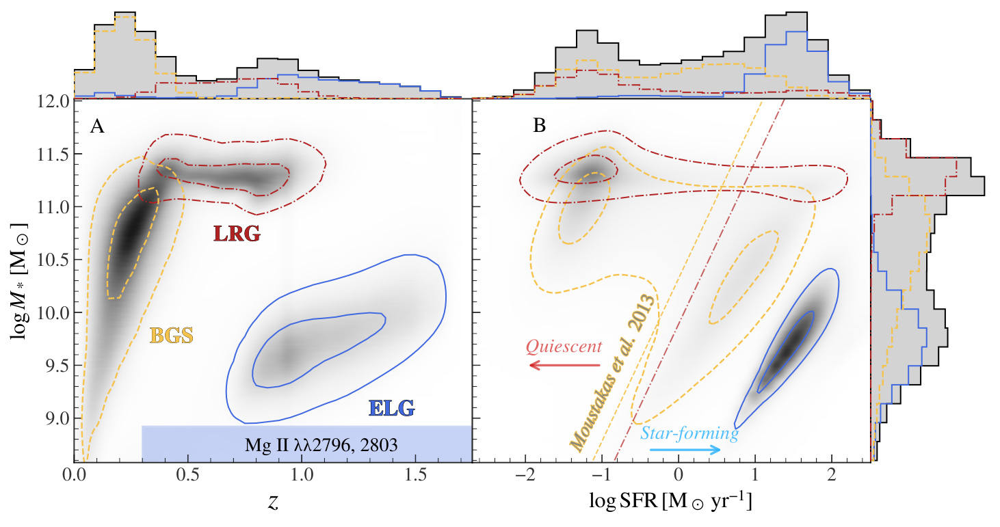

**Figure 1. -** Stellar mass, redshift, and star-formation-rate distributions of DESI Y1 galaxies. (A) Stellar mass as a function of redshift, with the full distribution shown in grayscale and colored contours distinguishing the DESI galaxy classes. (B) Stellar mass versus SFR for the same samples. The red and orange dashed lines mark the adopted star-forming/quiescent boundaries for LRGs and BGSs moustakas13. Contours enclose the 68\% and 95\% regions, and the side panels show the corresponding one-dimensional distributions. (*fig:Y1*)

**Figure 2. -** $W_{\rm MgII}$ as a function of projected distance for galaxies of different stellar masses.
Different symbols represent different galaxy types: ELGs (squares\,square), BGS galaxies (triangles\,triangle), and LRGs (circles\,circ).
(A) $W_{\rm MgII}$ as a function of projected distance $D$, colour-coded by $\log\langle M_*/\mathrm{M_\odot}\rangle$. The best-fit power-law profiles within 180 kpc are shown for ELGs (solid), BGS galaxies (dashed), and LRGs (dotted). The inset shows the corresponding $k$--$\log M_*$ relation. Both the inset and the displayed profiles are based on stacks constructed in fixed physical-distance bins.
(B) the same fixed-$D$ measurements displayed against $D/R_{\rm vir}$ using the representative $\langle R_{\rm vir}\rangle$ of each stellar-mass bin. A separate pair-by-pair $D/R_{\rm vir}$ re-stacking analysis is described in Appendix app:rvir. Horizontal error bars show the 1-sigma dispersion of projected distances contributing to each stack, while vertical error bars show the 1-sigma uncertainty in $W_{\rm MgII}$. The 180 kpc boundary is used as a common inner-CGM aperture rather than a universal virial radius. Measurements beyond 180 kpc and out to $\sim1\,R_{\rm vir}$ are shown as open symbols and broadly follow the extrapolation of the inner power-law fits. (*fig:D*)

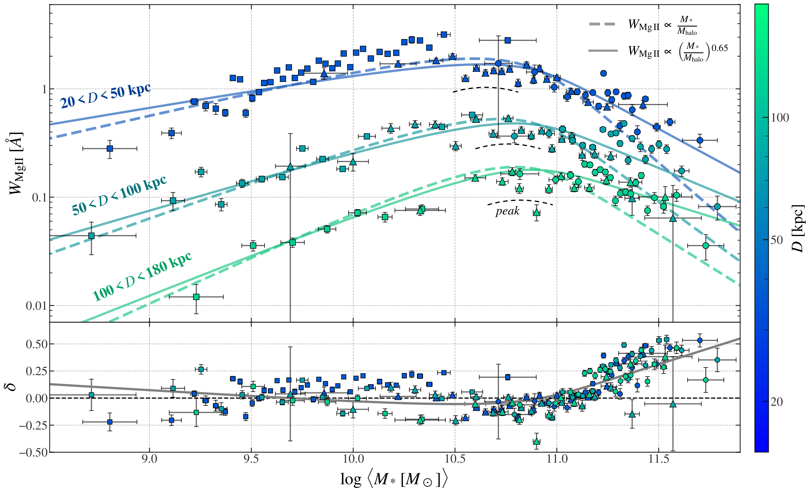

**Figure 3. -** Mass dependence of the Mg\,ii absorption normalization. The upper panel shows $W_{\rm MgII}$ as a function of $\log\langle M_*\rangle$ in three projected-distance intervals; the mean distances are encoded by the colour bar. Squares, triangles, and circles denote ELGs, BGSs, and LRGs, respectively. Dashed and solid curves show the two empirical scalings discussed in Section sec:normalization, $W_{\rm MgII}\propto M_*/M_{\rm halo}$ and $W_{\rm MgII}\propto(M_*/M_{\rm halo})^{0.65}$; the short black dashed curves indicate the maxima of the fiducial relations. The lower panel shows residuals from the fiducial model, $\delta=\log W_{\rm MgII}-\log W_{\rm MgII}^{\rm model}$; the grey curve gives the residual expected for the generalized scaling relative to the fiducial model. Horizontal error bars show the 1-sigma stellar-mass dispersion and vertical error bars show the 1-sigma uncertainty in $W_{\rm MgII}$. (*fig:normalization*)

**Figure 4. -** Empirical Mg\,ii absorption models in the stellar-mass--projected-distance plane. (A) Two-dimensional prediction of the fiducial SHMR-based model, $W^{\rm model}_{\rm MgII}\propto M_*/M_{\rm halo}$ (Equation eq:QR), fitted to ELGs and BGSs. (B) Corresponding prediction for the generalized scaling, $W^{\rm model'}_{\rm MgII}\propto(M_*/M_{\rm halo})^{0.65}$, fitted to all three galaxy classes. (C) Comparison of the fiducial model with the stacked measurements. (D) Comparison of the generalized model with the same measurements. In (C) and (D), squares, triangles, and circles denote ELGs, BGSs, and LRGs, respectively; grey error bars show measurement uncertainties, and the colour bar indicates stellar mass. Text labels give the mean offset and 1-sigma scatter for ELGs+BGSs (blue), LRGs (pink), and all galaxies (black); the uncertainty in $W_{\rm MgII}^{\rm model}$ includes the 1-sigma scatter in $M_*/M_{\rm halo}$ moster18. The largest systematic residuals occur for the most massive LRGs. (*fig:model*)

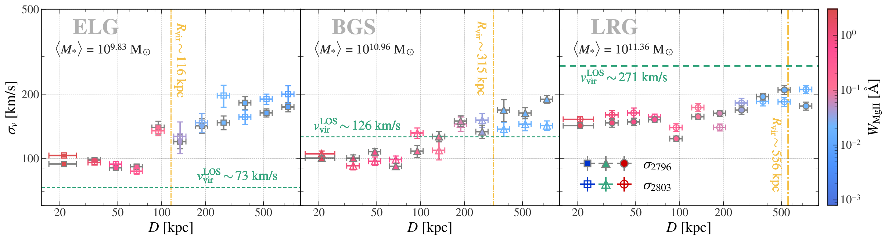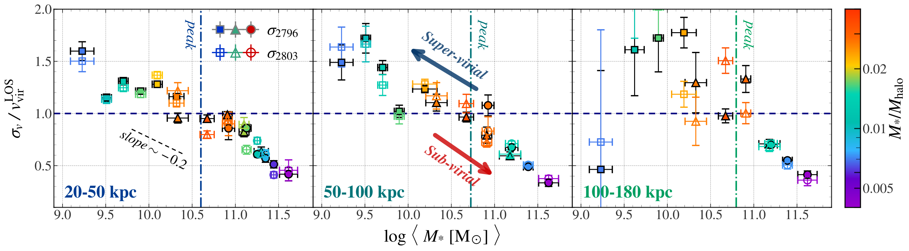

**Figure 5. -** Radial profiles and halo-normalized mass dependence of the stacked Mg\,ii velocity width. The upper row shows the corrected line-of-sight width, $\sigma_v$, as a function of projected distance for representative ELG, BGS, and LRG stacks with $\langle M_*\rangle=10^{9.83}$, $10^{10.96}$, and $10^{11.36}\,\mathrm{M_\odot}$, respectively. Filled and open symbols show Mg\,ii $\lambda2796$ and $\lambda2803$; colours encode $W_{\rm MgII}$. Vertical dot-dashed lines mark $R_{\rm vir}\simeq116$, 315, and 556 kpc, and horizontal dashed lines mark $v_{\rm vir}^{\rm LOS}\simeq73$, 126, and $271~\mathrm{km\,s^{-1}}$. The lower row shows $\sigma_v/v_{\rm vir}^{\rm LOS}$ as a function of stellar mass in the 20--50, 50--100, and 100--180 kpc intervals. Squares, triangles, and circles denote ELGs, BGSs, and LRGs; filled and open symbols show the two doublet transitions, and colours encode $M_*/M_{\rm halo}$. The horizontal dashed line marks unity, while vertical dot-dashed lines mark the peak mass of the fiducial absorption model in each distance interval. The ratio crosses unity near $\log(M_*/\mathrm{M_\odot})\simeq10.5$. Error bars show 1-sigma measurement uncertainties and the dispersion of the contributing projected-distance or stellar-mass distributions. (*fig:kinematic-transition*)

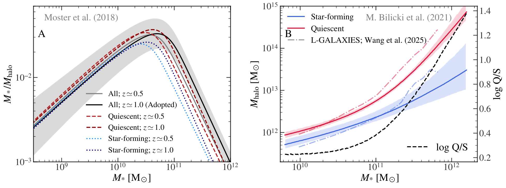

**Figure 6. -** Stellar-to-halo mass relation and halo mass growth for different galaxy populations. 
(A) Stellar-to-halo mass ratio $M_*/M_{\rm halo}$ as a function of stellar mass $M_*$ at $z\approx0.5$ and $z\approx1.0$. 
The black curve and grey band show the relation and $1\,\sigma$ uncertainty for the full galaxy sample at $z\sim1$ from moster18. 
Red and blue curves denote quenched and star-forming centrals, respectively, at the two redshifts. 
(B) Median halo mass $M_{\rm halo}$ versus $M_*$ at low redshift from bilicki21, for star-forming (blue) and quiescent (red) centrals; shaded regions are their $1\,\sigma$ confidence intervals. The dot-dashed lines show the same quantities predicted by the L-GALAXIES semi-analytic model wang2025.
The black dashed curve indicates the logarithm of the quiescent-to-star-forming halo-mass ratio, $\log(Q/S)$, derived from bilicki21. (*fig:moster*)

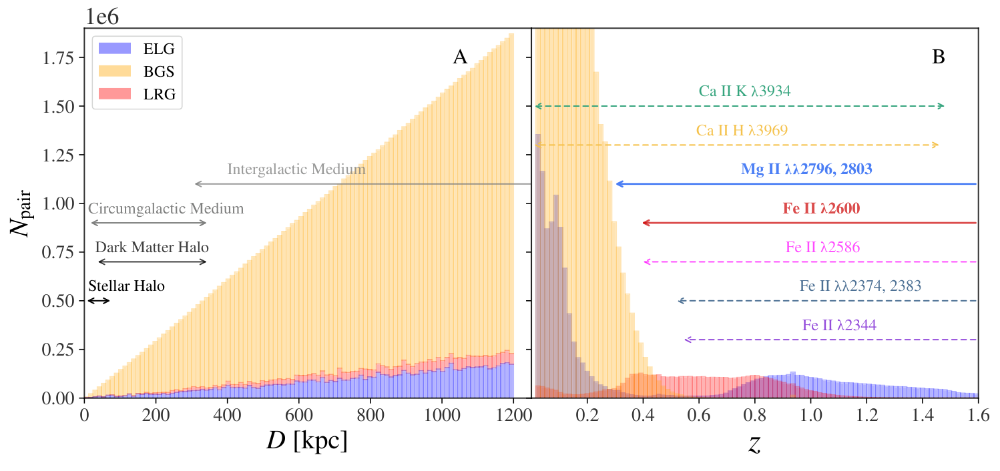

**Figure 7. -** Distribution of galaxy--quasar pairs in projected distance and redshift. Histograms show the number of galaxy--quasar pairs (Npair) as a function of projected distance $D$ in (A) and redshift $z$ in (B) for three galaxy populations in the DESI Y1 sample: ELGs (blue), LRGs (red), and BGSs (orange). Grey horizontal arrows reproduce the schematic physical-scale guides shown in the left panel and should not be interpreted as sharp boundaries between stellar halos, dark matter halos, the CGM, and the IGM. In the right panel, horizontal colored arrows mark the redshift ranges over which various absorption features---such as Ca\,ii H and K, Mg\,ii, and Fe\,ii transitions---are covered by the DESI spectral range. The two lines adopted in this work, Mg\,ii\,$\lambda\lambda$2796, 2803 and Fe\,ii\,\lambda2600, are highlighted in bold. (*fig:pair*)

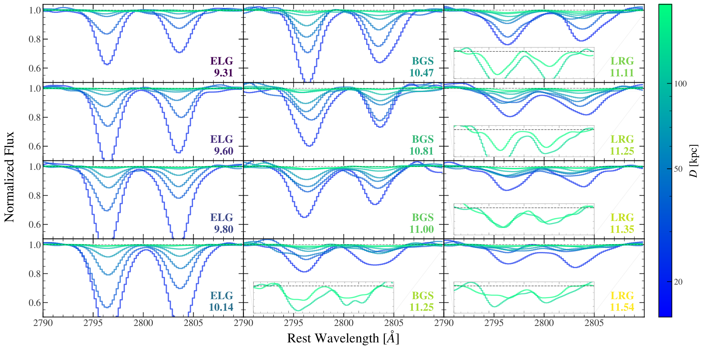

**Figure 8. -** Mg\,ii absorption profiles across galaxy population and stellar mass. Columns show ELGs (left), BGSs (centre) and LRGs (right), and rows show stellar-mass bins; inset labels give $\log\langle M_*/\mathrm{M_{\odot}}\rangle$. Curves show Gaussian-smoothed normalized flux over rest-frame wavelengths of 2790--2810 AA\ for seven projected-distance bins. Colours encode $D$ as indicated by the colour bar on the right. Insets in the bottom-row BGS and LRG panels magnify the two largest-$D$ profiles; the dashed line marks unit continuum. (*fig:specall*)

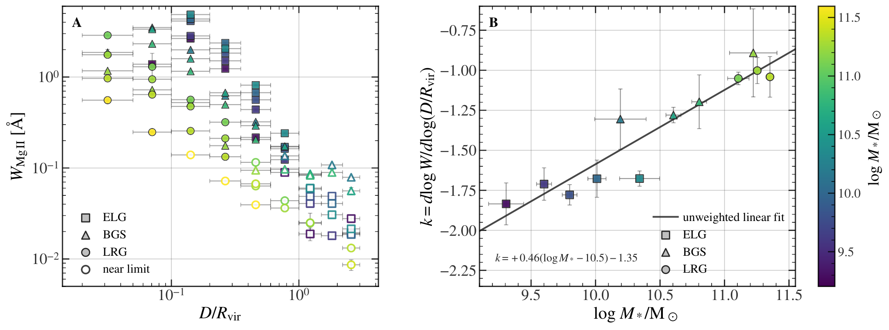

**Figure 9. -** Mg\,ii equivalent width as a function of normalized projected distance. (A) The stacked $W_{\rm Mg\,II}$ measurements are shown against $D/R_{\rm vir}$. For this test, $R_{\rm vir}$ is evaluated for each galaxy and each galaxy--quasar pair is assigned to a radial bin using its own $D/R_{\rm vir}$ before stacking. This differs from the right panel of Figure fig:D, where the original fixed-$D$ stacks are only displayed relative to a representative bin-averaged virial radius. (B) The corresponding power-law slope $k=d\log W/d\log(D/R_{\rm vir})$ is shown as a function of stellar mass. Symbols indicate DESI target class and are colour-coded by stellar mass; open symbols in the left panel denote measurements close to the adopted detection or line-depth quality threshold. The persistence of the mass-dependent radial slope in the pair-level normalized stacks shows that the $k$--$M_*$ relation is not an artefact of using fixed physical-distance bins. (*fig:ewrvir*)

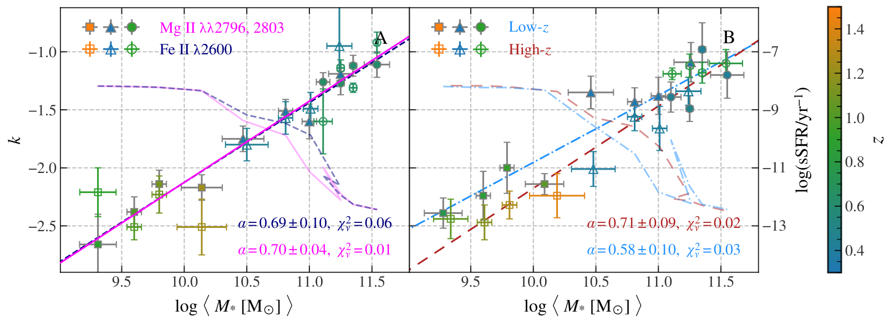

**Figure 10. -** Robustness of the radial-slope--stellar-mass relation. (A) slopes $k$ of the equivalent-width--distance relations measured from Mg\,ii\,$\lambda\lambda2796,2803$ (filled symbols) and Fe\,ii\,$\lambda2600$ (open symbols) stacks as a function of stellar mass. (B) each Mg\,ii stellar-mass bin is divided at its median redshift; filled and open symbols denote the lower- and higher-redshift halves, respectively. The quantity $a_k$ shown in the panel denotes the descriptive slope of a plotted $k$--$\log M_*$ fit, $a_k=d k/d\log M_*$. The coloured fit lines are shown only as visual summaries of the plotted subsamples; because the DESI target classes occupy different stellar-mass and redshift ranges, our robustness inference is based primarily on the within-bin comparison of the low- and high-redshift measurements rather than on interpreting a single global fit across target classes. The broken curves are retained only to guide the eye through the median $\log({\rm sSFR})$ values associated with the plotted subsamples. Apparent bends can occur where the sequence passes between differently selected DESI target classes; the curves are not fitted and are not interpreted as a continuous physical sSFR--mass relation. Mg\,ii and Fe\,ii exhibit similar $k$--$M_*$ behaviour, and the redshift-split measurements show that the radial-slope trend remains visible when redshift differences are tracked. (*fig:k-M*)

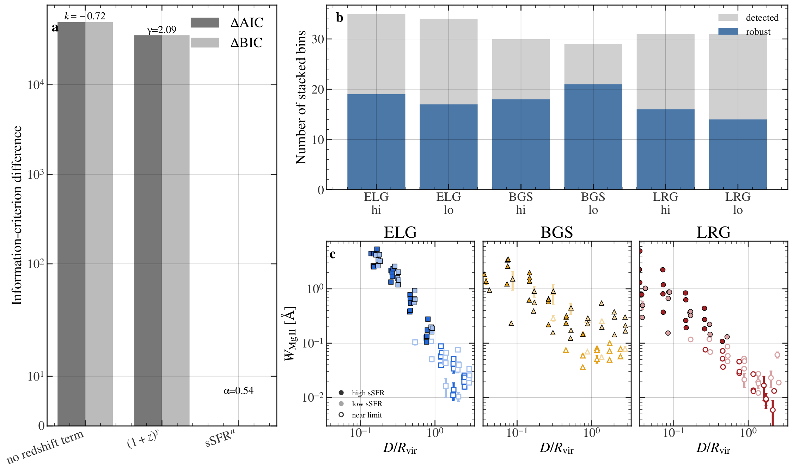

**Figure 11. -** Robustness of the radial-slope--stellar-mass relation.
(A) Power-law slopes $k$ of the equivalent-width--distance relations measured from Mg\,ii\,$\lambda\lambda2796,2803$ (filled symbols) and Fe\,ii\,$\lambda2600$ (open symbols) stacks as a function of stellar mass.
(B) The Mg\,ii measurements split at the median redshift within each stellar-mass bin; filled and open symbols denote the lower- and higher-redshift subsamples, respectively.
The quantity $a_k=d k/d\log M_*$ gives the descriptive slope of the plotted $k$--$\log M_*$ relation. Coloured lines are shown as visual summaries, while the broken curves trace the median $\log(\mathrm{sSFR})$ values for guidance only.
The similar Mg\,ii and Fe\,ii trends, together with the consistency of the redshift-split measurements, show that the radial-slope variation is primarily associated with stellar mass rather than redshift. (*fig:modelselection*)

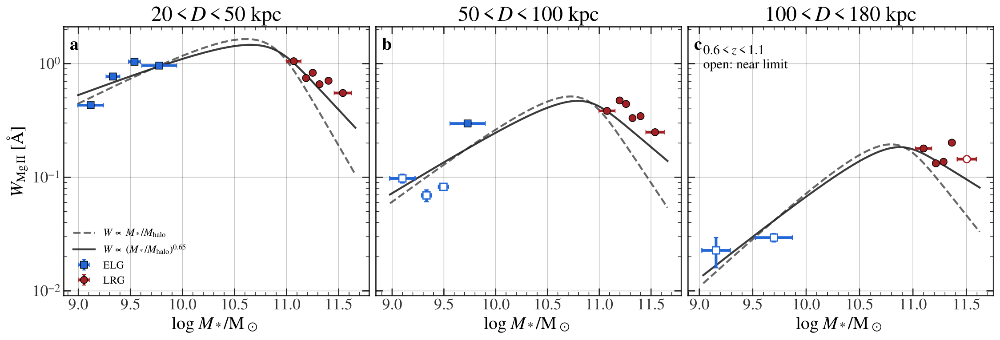

**Figure 12. -** Redshift-controlled ELG/LRG Mg\,ii stacks. The $W_{\rm MgII}$--$M_*$ measurements are repeated using only $0.6<z<1.1$, where ELGs and LRGs substantially overlap in redshift. Panels (A), (B), and (C) correspond to $20<D<50$, $50<D<100$, and $100<D<180$ kpc, respectively. Filled points satisfy the conservative signal-to-noise and doublet-depth cuts; open points lie near the adopted detection or quality limit. Dashed and solid curves reproduce the $W_{\rm MgII}\propto M_*/M_{\rm halo}$ and $W_{\rm MgII}\propto(M_*/M_{\rm halo})^{0.65}$ empirical relations from Figure fig:normalization, carried over without refitting to the restricted-redshift sample. BGS galaxies are omitted because their useful Mg\,ii redshift coverage is largely disjoint from this interval. (*fig:zoverlap*)

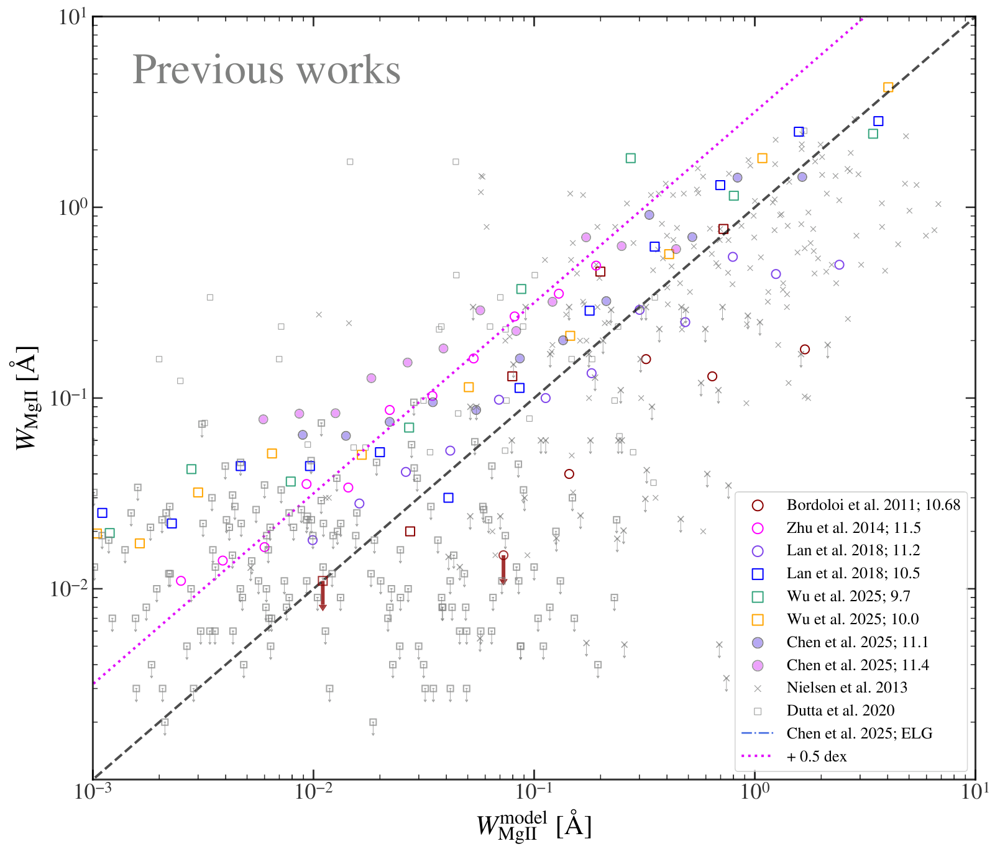

**Figure 13. -** Comparison of observed and modelled Mg\,ii equivalent widths. Literature measurements of $W_{\rm MgII}$ are shown against the prediction $W_{\rm model}$ from Equation eq:QR. Symbols denote bordoloi11 (dark-red open squares and circles), zhu14 (magenta open circles), lan18 (blue open squares and circles), wu2024 (green and orange open squares), chen25 (filled circles and blue dotted curves), nielsen13,nielsen13b (grey crosses; individual absorbers) and dutta20 (grey open squares; individual absorbers). The dotted magenta line marks a 0.5-dex excess above the model prediction. Squares and circles denote ELG and LRG measurements, respectively. Blue curves show the best-fitting relations within 100 kpc for ELGs with stellar masses of $10^{8.8}$, $10^{9.8}$ and $10^{10.5}\,\mathrm{M_\odot}$ from chen25. Numeric labels give $\log(M_*/\mathrm{M_\odot})$ for each sample. Stellar masses from nielsen13,nielsen13b are converted from absolute $K$-band magnitude using $\log(M_*/\mathrm{M_\odot})=-0.4(M_K-3.28)+\log0.6$ McGaugh14. (*fig:compare*)

